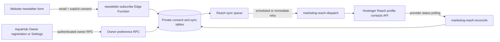

# Hostinger Reach integration

**Production status (2026-10-10): backend and website deployed; live Reach synchronization remains disabled.** The production migration is applied, all three Reach Edge Functions are active, the required Supabase secret names are present, and the two Vault-backed Cron jobs are active. `HOSTINGER_REACH_ENABLED` is set to `false`. The public newsletter endpoint and consent storage were smoke-tested with a synthetic `.invalid` address; its subscriber row was removed afterward. No Reach contact, confirmation, or welcome email was sent. Reach profile settings, token acceptance, sender verification, reply mailbox, and welcome automation still require dashboard verification.

## Architecture



The existing marketing site is static HTML/CSS/JavaScript in `aquahub-website/` and is deployed through Firebase Hosting (`firebase.json`, with a separate staging target in `firebase.staging.json`). It has no frontend framework or build step for these newsletter assets. The website sends only email, optional first name, explicit consent, and an anti-bot honeypot to Supabase. It does not receive subscriber data or call Hostinger directly. The public endpoint only stores consent and queues contact synchronization. The bounded dispatcher handles contact synchronization; a separate scheduled server-only worker reconciles provider unsubscribes. Owner registration consent is optional and unchecked; account creation and essential verification/service emails remain independent. The Owner Settings preference uses guarded Supabase RPCs tied to the authenticated owner.

The subscriber and consent-event tables live in the non-public `app_private` schema with RLS enabled and all direct grants revoked. Server-only RPCs record consent, claim queue rows with a lease, and update provider status. Local consent and Reach-reported status are separate values. The integration never infers that Reach subscribed a contact just because consent was recorded.

## Required configuration

### Supabase Edge Function secrets

Set these in the Supabase project’s Edge Function secrets. Use different values for development, staging, and production.

| Name | Purpose |
| --- | --- |
| `HOSTINGER_REACH_API_TOKEN` | Dedicated bearer token created under Hostinger hPanel → API with Reach access |
| `HOSTINGER_REACH_PROFILE_UUID` | Reach profile to receive contacts |
| `HOSTINGER_REACH_ENABLED` | Set to `true` only after dashboard setup and controlled verification; defaults to disabled |
| `HOSTINGER_REACH_DOUBLE_OPT_IN` | Mirror of the selected Reach profile’s double opt-in setting |
| `NEWSLETTER_ALLOWED_ORIGINS` | Exact comma-separated website origins allowed by the public endpoint |
| `NEWSLETTER_RATE_LIMIT_HMAC_KEY` | Random server-only key used to HMAC IP/email rate-limit fingerprints |
| `NEWSLETTER_CONSENT_POLICY_VERSION` | Version recorded with explicit consent |
| `MARKETING_DISPATCH_SECRET` | Random server-only bearer secret for scheduled dispatcher/reconciliation calls |

Supabase supplies `SUPABASE_URL` and `SUPABASE_SERVICE_ROLE_KEY` to the Edge Function runtime. Never put the service-role key, Reach token, HMAC key, or dispatcher secret in website assets, Android configuration, logs, or Git.

Create a dedicated Hostinger API token in **hPanel → API** and grant only the Reach permissions required by the integration. Use the Reach **List Profiles** endpoint in the [official API reference](https://docs.hostinger.com/api-reference/endpoints/reach/profiles) to identify the target profile UUID. Do not reuse a broad personal token if a restricted token is available.

### Website public configuration

Set `aquahub-website/newsletter-config.js` to the Supabase project URL:

```js
window.AQUAHUB_NEWSLETTER_CONFIG = {
  supabaseUrl: "https://<project-ref>.supabase.co"
};
```

The URL is public configuration. The website does not need an anon key for this function because the endpoint has JWT verification disabled and performs its own origin, consent, validation, and rate-limit checks. The form stays disabled while the URL is blank.

Configure `NEWSLETTER_ALLOWED_ORIGINS` with exact origins, such as `https://aquahub.aesprt.com`; do not include paths or trailing slashes. Add local/staging origins only to their matching environment.

## Reach API and contact handling

The implementation uses the documented profile-specific API under `https://developers.hostinger.com/api/reach/v1/profiles/{profileUuid}`:

- `POST /contacts` with `email`, optional `name`, and existing `tag_uuids`.
- `GET /contacts` for exact-email preflight and subscription-status lookup.
- `POST /tags` to create or find the AquaHub tags idempotently.
- `GET /contacts/{contactUuid}` to read the current provider status and tag UUIDs.
- `POST /tags/{tagUuid}/contacts/{contactUuid}` and `DELETE` on that path to reconcile tags idempotently.
- `DELETE /contacts/{contactUuid}` to remove a contact after an AquaHub owner withdraws consent.
- `GET /contacts?subscription_status=unsubscribed` for suppression reconciliation.

The API returns an acknowledgement for contact creation rather than a contact resource. The worker looks the contact up afterward and only stores its UUID/status and confirmation state when Reach returns them. If a contact already exists, it does not submit a second create request or retrigger the welcome automation. If Reach says the contact is unsubscribed or suppressed, the worker does not add it again. A provider acknowledgement without a returned status leaves the local confirmation state unknown until Reach reports it.

API 429 responses honor `Retry-After`; other transient failures use a bounded exponential retry schedule. Authentication/configuration failures are stored as safe error codes and retried at a slower interval. Logs contain event/error codes only, never subscriber email, token, or provider response body.

### Tags and audiences

The worker creates or finds tags as needed:

- Every eligible contact: `aquahub-newsletter`
- Website signup: `aquahub-website`, `aquahub-prospect`
- Owner signup: `aquahub-owner`
- Free owner: `aquahub-free-plan`
- Starter owner: `aquahub-starter-plan`, `aquahub-paid-plan`
- Business owner: `aquahub-business-plan`, `aquahub-paid-plan`
- Pro owner: `aquahub-pro-plan`, `aquahub-paid-plan`

Create Reach segments that also require Reach’s subscribed/confirmed status:

- **Prospects:** `aquahub-prospect` and `aquahub-newsletter`
- **Free owners:** `aquahub-owner` and `aquahub-free-plan`
- **Starter owners:** `aquahub-owner` and `aquahub-starter-plan`
- **Business owners:** `aquahub-owner` and `aquahub-business-plan`
- **Pro owners:** `aquahub-owner` and `aquahub-pro-plan`
- **All paid owners:** `aquahub-owner` and `aquahub-paid-plan`
- **Suppressed:** Reach unsubscribed/suppressed status; exclude these contacts from every promotional segment

Do not include pending double-opt-in contacts in campaigns. Subscription plan changes enqueue a sync for already-consented owners. The worker reads current Reach tags, removes stale AquaHub audience tags, and applies the plan tag through Reach's documented tag endpoints. It never updates an unsubscribed/suppressed Reach contact. The five-minute dispatcher drains these queued tag refreshes; provider status reconciliation remains a separate daily job.

## Double opt-in and welcome automation

The public API accepts a contact request; it does not itself guarantee that a Reach form-submission automation will fire. Hostinger documents the dedicated “contact submits form” trigger for forms created in Reach. For this custom website/app integration, configure a segment-entry/tag-based automation instead. The workflow must require Reach’s subscribed/confirmed state and AquaHub’s newsletter tag. Disable re-entry or otherwise configure it to send one welcome message per eligible contact.

1. In Reach, verify whether double opt-in is enabled for the target profile. Set `HOSTINGER_REACH_DOUBLE_OPT_IN` to the same value.
2. Create the AquaHub segments above, requiring subscribed/confirmed status.
3. Create an automation triggered by **Contact entered segment** for the intended opted-in audience. Do not select “Contact submits Reach form” for this external form; that trigger only accepts forms created directly in Reach.
4. Choose **New contacts only** for the segment trigger, then add a single welcome-email step. The segment must require both the AquaHub newsletter tag and Reach’s subscribed status. With double opt-in enabled, the contact must confirm before it enters this eligible segment.
5. Set the sender display name to **AquaHub Support**, sender address to **support@aquahub.aesprt.com**, reply-to to the address that will actually receive replies, and subject to **Welcome to AquaHub! 💧**.
6. Use this welcome email and include Reach’s unsubscribe control:

   **Welcome to AquaHub! 💧**

   > Welcome to AquaHub!
   >
   > Thank you for joining our community.
   >
   > AquaHub helps water refilling station owners manage their business more efficiently with sales tracking, inventory management, mobile ordering, deliveries, reports, and more.
   >
   > We're excited to share product updates, helpful tips, and exclusive offers with you.
   >
   > Explore AquaHub: https://aquahub.aesprt.com
   >
   > The AquaHub Team

   Add Reach’s unsubscribe footer and send only after the contact meets the automation’s opted-in/confirmed audience criteria.
7. Confirm the automation is available on the connected plan. Hostinger currently documents Reach automations as plan-dependent (including paid Reach plans); verify the current plan in the Reach dashboard before enabling it.

The automation must be created and activated in Hostinger Reach’s dashboard. The public API reference exposes automation reads but no create/activate workflow operation, so this repository does not claim to configure it automatically.

Official references: [Hostinger API overview](https://docs.hostinger.com/api-reference/overview), [Reach contacts API](https://docs.hostinger.com/api-reference/endpoints/reach/contacts), [Reach profile API](https://docs.hostinger.com/api-reference/endpoints/reach/profiles), [automations from form submissions](https://www.hostinger.com/support/hostinger-reach-automate-emails-from-form-submissions/), [segment-entry automation trigger](https://www.hostinger.com/changelog/new-trigger-contact-joins-a-segment), [double opt-in](https://www.hostinger.com/support/hostinger-reach-double-opt-in-explained-and-how-to-use-it/), and [Reach plan feature guidance](https://www.hostinger.com/support/hostinger-reach-how-to-send-automated-emails-after-a-form-submission-using-hostinger-ai-builder-manual-mode/).

## Consent and unsubscribe behavior

- Website sign-up requires the visitor to tick an unchecked consent box. Missing consent is rejected by the server.
- Owner account creation does not enroll an owner unless they opt in. Owners can later change the preference in Settings.
- An owner preference change is saved in Supabase first. Turning marketing off queues Reach contact removal; account, security, and service notifications are unchanged.
- A Reach unsubscribe is discovered by the scheduled reconciliation function. It updates only the stored Reach status and prevents future synchronization; it does not rewrite the original consent event.
- The current public Reach API inventory does not document an unsubscribe webhook or subscription-status write endpoint. Reconciliation therefore polls Reach’s unsubscribed-contact list; changes may not appear in AquaHub until the next successful run.
- Reach removal is represented as contact deletion, not as an API-written unsubscribe status. AquaHub retains its local withdrawal/suppression record and does not automatically recreate the contact. A fresh, explicit consent action is required before any later synchronization; a provider-reported unsubscribe remains suppressed.
- The reconciliation function reads at most 80 pages (8,000 contacts) per run to stay below the documented per-minute API ceiling. If the profile has more than 8,000 unsubscribed contacts, reconcile additional pages in a controlled, rate-limited run before treating the import as complete.

Configure Reach’s own unsubscribe link and suppression behavior for every campaign. Do not import scraped lists or enroll all registered owners.

## Sender identity and DNS

Read-only DNS lookups on 2026-10-10 found:

- `aquahub.aesprt.com` has one SPF TXT record: `v=spf1 include:_spf.firebasemail.com include:_spf.reach.hostinger.com ~all`. It already includes both Firebase mail and Hostinger Reach; do not add a second SPF record or replace this record blindly.
- `aesprt.com` has its own SPF record, `v=spf1 include:_spf.mx.cloudflare.net ~all`. This is a separate hostname policy.
- DMARC is currently `p=none` at both `_dmarc.aesprt.com` and `_dmarc.aquahub.aesprt.com`.
- `aesprt.com` publishes Cloudflare MX records. `aquahub.aesprt.com` has no MX record, so DNS does not establish that `support@aquahub.aesprt.com` can receive replies. Verify the actual mailbox/routing with the mail provider and use a monitored reply-to address.

1. In Hostinger Reach, add/verify the sender domain `aquahub.aesprt.com` and copy the exact records Reach supplies.
2. Inspect the existing DNS zone before changing anything. Preserve Firebase Hosting and other records.
3. Recheck the current SPF TXT record before any change. The lookup above already contains Hostinger's Reach include; only follow new dashboard instructions if Reach explicitly reports a missing record, and merge any required include into the existing policy. Never publish a second independent SPF record for the same hostname.
4. Add the Hostinger-provided DKIM records exactly as shown. Do not invent selector names or targets.
5. Inspect `_dmarc.aesprt.com` and the sender-domain DMARC policy. Keep the existing policy unless the domain owner approves a deliberate change.
6. Verify sender-domain status in Reach after DNS propagation.
7. Verify separately that `support@aquahub.aesprt.com` is a real mailbox or forwarding address and can receive replies. This workspace could not confirm mailbox existence. A verified marketing sender does not prove that replies are delivered.
8. Set the Reach reply-to address to a monitored mailbox and use the unsubscribe footer supplied by Reach. The DNS lookup alone cannot verify mailbox access or delivery.

No DNS records were changed by this implementation.

## Production deployment record

- Migration `20261010123000_hostinger_reach_marketing` is applied and is no longer pending.
- `newsletter-subscribe`, `marketing-reach-dispatch`, and `marketing-reach-reconcile` are deployed with `verify_jwt = false`. The public function checks the configured origin, input, explicit consent, request size, honeypot, and HMAC rate limits. The internal functions check the dedicated bearer secret in constant time.
- The production origin allow-list is `https://aquahub.aesprt.com`. The public function returned the matching CORS response during preflight.
- `pg_cron` and `pg_net` are enabled. Vault contains `marketing_project_url` and `marketing_dispatch_secret`; the dispatch secret was generated and synchronized without writing its value to a file in the repository or printing it.
- `aquahub-reach-dispatch` runs every five minutes. `aquahub-reach-reconcile` runs daily at 03:02 UTC. Both jobs are active. The dispatch job has executed. While the integration flag is false, the internal function returns `503 integration_unavailable`; this gate was verified with the configured bearer secret, and no provider request is made.
- The static website is deployed to the existing Firebase Hosting production site. Homepage, privacy, and browser-ordering routes returned successfully. Product pricing and the Customer browser-ordering message are covered by the passing website tests.
- The flag remains false until the Reach dashboard settings below are verified and a controlled test is explicitly authorized. No DNS records or live campaigns were changed.

## Remaining Hostinger dashboard setup

1. In Reach, confirm the intended profile and double opt-in setting. Ensure `HOSTINGER_REACH_DOUBLE_OPT_IN` mirrors the profile setting. Confirm the API token has Reach contact and tag permissions; the token value and API authentication have not been tested.
2. The contact sync can idempotently create missing tags through the supported Reach tag API when the first eligible sync runs. Verify `aquahub-newsletter`, `aquahub-website`, `aquahub-prospect`, `aquahub-owner`, `aquahub-free-plan`, `aquahub-starter-plan`, `aquahub-business-plan`, `aquahub-pro-plan`, and `aquahub-paid-plan` in Reach. Segments and automations still require the Reach dashboard.
3. Create prospect and owner plan segments that require Reach subscribed/confirmed status. Exclude unsubscribed or suppressed contacts from every campaign. For contacts added through AquaHub’s API, use **Contact entered segment**, set the welcome flow to new contacts only, and disable re-entry. The **Contact submits form** trigger applies to forms created in Reach, not this external website form.
4. Configure one welcome email with sender **AquaHub Support**, `support@aquahub.aesprt.com`, subject **Welcome to AquaHub! 💧**, and Reach’s unsubscribe control. Verify the plan includes automation and verify sender-domain status in Reach.
5. Confirm that `support@aquahub.aesprt.com` receives replies or set a monitored reply-to address. The DNS snapshot shows Reach’s SPF include already present, but DKIM status and mailbox delivery remain unverified. Do not add or replace DNS records without the exact records from Reach and a review of the existing zone.
6. Keep `HOSTINGER_REACH_ENABLED=false` until the profile, consent rules, tags, segments, automation, and sender are verified. Then obtain explicit authorization for a controlled test recipient before enabling live synchronization or sending a welcome message. Do not activate campaigns or send bulk email as part of this setup.

To pause the integration, set `HOSTINGER_REACH_ENABLED=false`, stop both scheduled calls, and leave stored consent/suppression records intact. To roll back website code, use Firebase Hosting release history to restore the prior version. Do not drop consent tables as a routine rollback because that would discard suppression history. Supabase’s supported schedule pattern uses `pg_cron`, `pg_net`, and Vault ([Scheduling Edge Functions](https://supabase.com/docs/guides/functions/schedule-functions)).

## Local validation and troubleshooting

- Website tests: `node --test test/*.test.js` from `aquahub-website/`.
- Reach helper tests: `deno test supabase/functions/_shared/marketing.test.ts supabase/functions/_shared/hostinger-reach.test.ts supabase/functions/_shared/marketing-sync.test.ts supabase/functions/_shared/request-body.test.ts`.
- SQL authorization invariants: `supabase test db` against the local test database after migrations are applied.
- Marketing subscription database behavior: `supabase test db --local tests/marketing_consent.sql tests/marketing_plan_sync.sql` against an isolated local database.
- Owner app: `./gradlew testQaDebugUnitTest testProductionDebugUnitTest assembleQaDebug assembleProductionDebug` from `AquaHub/`.
- Use mocks for API behavior tests. Automated tests must not contact a real Reach profile or send email.

Troubleshooting:

- **Form disabled:** fill the public Supabase URL in `newsletter-config.js`.
- **CORS/origin error:** add the exact website origin to `NEWSLETTER_ALLOWED_ORIGINS` and redeploy the function.
- **Queued sync:** check whether `HOSTINGER_REACH_ENABLED` is true, secrets are set, and the dispatcher schedule is running.
- **401/403 from Reach:** rotate/fix the server-side API token; never put it in browser code.
- **429:** inspect the returned retry schedule; the worker honors `Retry-After`.
- **No welcome email:** check DOI confirmation, subscribed segment criteria, tag assignment, automation plan eligibility, single-send/re-entry settings, and sender verification in Reach.
- **Unsubscribe not reflected yet:** confirm the reconciliation schedule and Reach API status; a poll delay is expected because no webhook was found in the current public API.

## Implementation files

- `aquahub-website/index.html`, `styles.css`, `newsletter*.js`, and `privacy.html`
- `supabase/migrations/20261010123000_hostinger_reach_marketing.sql`
- `supabase/functions/newsletter-subscribe/`, `marketing-reach-dispatch/`, `marketing-reach-reconcile/`, and `_shared/`
- Owner registration/settings consent flow under `AquaHub/app/src/main/java/com/aesprt/aquahub/`
